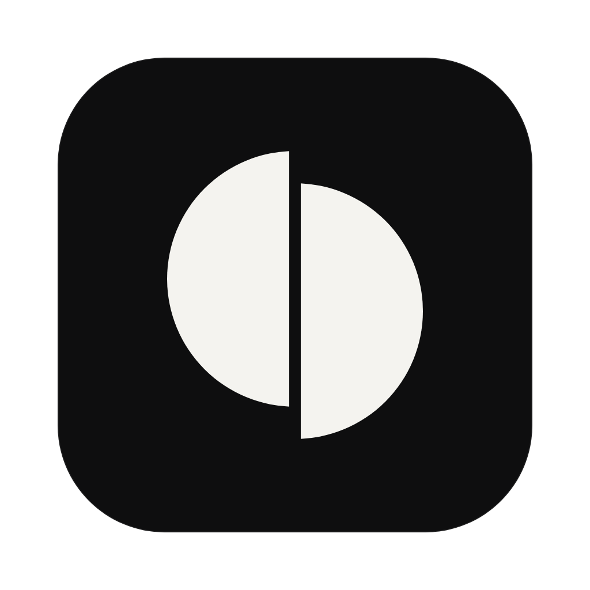

<p align="center">
  
</p>

<h1 align="center">Cutroom</h1>

<p align="center">
  Edit video by talking to the coding agent you already use.<br/>
  Claude Code, Codex or Pi edits the timeline. <a href="https://videodb.io">VideoDB</a> sees, searches and renders the footage.
</p>

<p align="center">
  <a href="https://github.com/omgate234/cutroom/releases/latest"><b>Download for macOS</b></a>
</p>

---

## What it does

- Drop in footage. Each video is uploaded to VideoDB, transcribed and described shot by shot.
- Ask for an edit: "a 30 second highlight with captions", "remove the ums and silences", "a vertical short from the best moment".
- The agent reads the transcripts, searches the footage, looks at frames, writes `timeline.json` and checks its own cuts. Every save renders a live preview.
- Drag clips, undo any change, or restore any earlier version. Export an MP4 when it looks right.
- The agent can use the rest of VideoDB too: search your whole library, reframe, dub, generate music or voice.

## Install

1. Download the DMG for your Mac from [Releases](https://github.com/omgate234/cutroom/releases/latest) (`arm64` for Apple silicon, `x64` for Intel).
2. Drag Cutroom to Applications.
3. The app is not notarized yet. On first launch macOS will refuse to open it; run this once, then open it normally:

   ```sh
   xattr -dr com.apple.quarantine /Applications/Cutroom.app
   ```

You also need:

- A VideoDB API key, free at [console.videodb.io](https://console.videodb.io).
- At least one agent installed and signed in: [Claude Code](https://docs.anthropic.com/en/docs/claude-code), [Codex](https://github.com/openai/codex) or [Pi](https://github.com/earendil-works/pi) (0.81+).

Onboarding checks all of this and can install the [VideoDB skills](https://github.com/video-db/skills) for each agent.

## How it works

Cutroom is an [Agent Client Protocol](https://agentclientprotocol.com) client. It starts your agent through its ACP adapter, runs it inside the project folder, and gives it VideoDB tools over MCP (and as a `vdb` shell command for agents without MCP).

A project is a plain folder, kept in `~/.cutroom/projects/`:

| File | Purpose |
|---|---|
| `project.json` | Name and description: the brief for the edit |
| `timeline.json` | The edit, in VideoDB's timeline format |
| `assets.json` | Imported media and indexing status |
| `media/<id>/` | Transcript, word timings and scene descriptions per video |
| `AGENTS.md`, skills | Instructions the agent reads |

Every agent turn and manual edit is a git commit, so history and undo come for free.

## Develop

```sh
npm install
npm run dev        # run the app
npm run build:mac  # build DMGs into dist/
```

Electron, React, [shadcn/ui](https://ui.shadcn.com), Tailwind. Main process in `src/main`, the MCP server and CLI in `src/mcp`, shared VideoDB and timeline code in `src/shared`, UI in `src/renderer`.

## License

MIT
